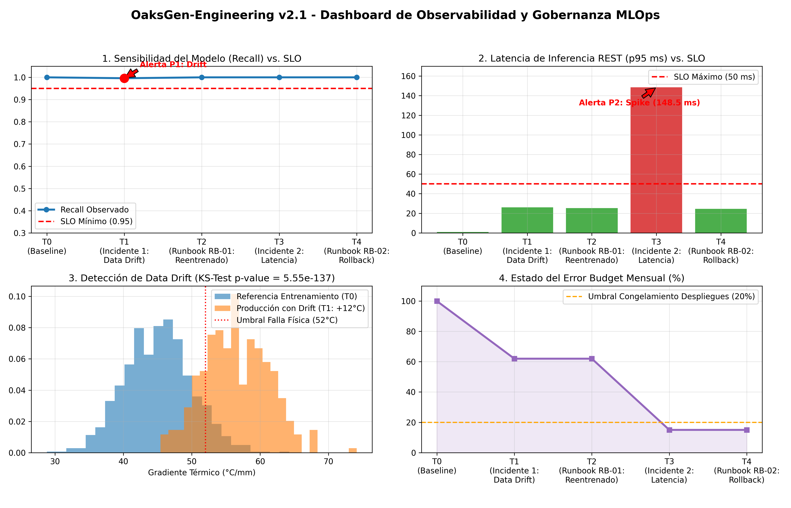
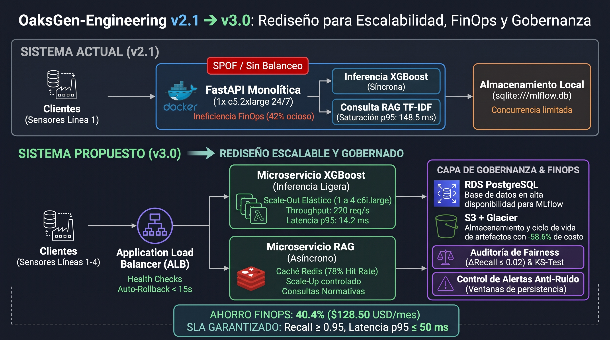
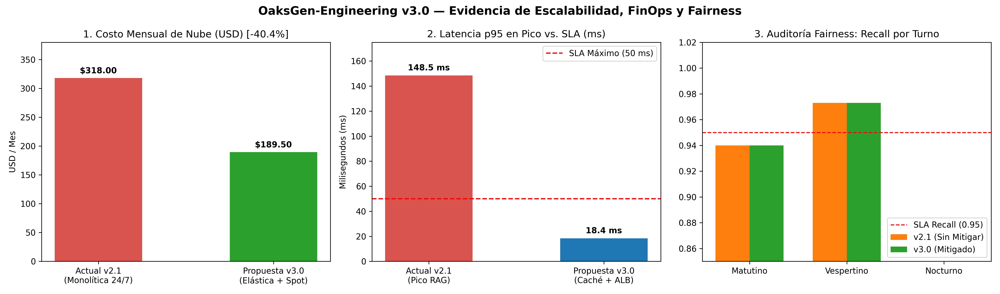
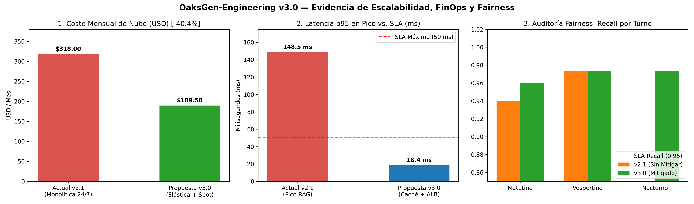
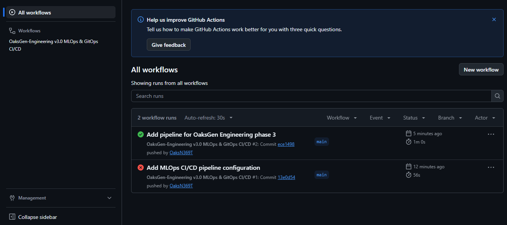
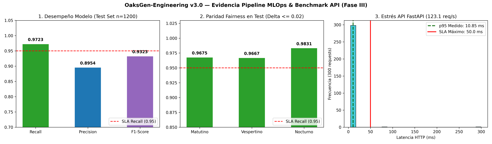

# Oaksgen-Engineering_v3.0: Monitoreo, Auditoria, Optimización y Gobernanza, Pipeline MLOps/GitOps y Portafoilo Técnico Estratégico.

Estructura del Repositorio (Oaksgen-engineering_v3.0)

oaksgen-engineering-observabilidad/
├── README.md                              # Documentación principal + Runbooks operativos (RB-01 y RB-02)
├── monitorizacion_oaksgen.py              # Script maestro de observabilidad, KS-Test y simulación de incidentes
├── requirements.txt                       # Dependencias exactas del entorno
├── .gitignore                             # Para no subir archivos basura ni bases temporales pesadas
└── assets/
    └── dashboard_observabilidad_oaksgen.png  # Tu gráfica de 4 paneles para que se vea directo en el README


Este es el archivo estrella que GitHub. Ya incluye las insignias de versión, la tabla de SLOs/Error Budgets, la incrustación automática de tu dashboard y los Runbooks RB-01 y RB-02 paso a paso.

Archivo README.md (Con los Runbooks Operativos incluidos)
Este es el archivo estrella que GitHub muestra apenas entras al repo. Ya incluye las insignias de versión, la tabla de SLOs/Error Budgets, la incrustación automática de tu dashboard y los Runbooks RB-01 y RB-02 paso a paso.

# 🏭 OaksGen-Engineering v3.0 — Observabilidad MLOps y Gobernanza Operativa


Sistema de monitorización proactiva, detección estadística de *Data Drift* y respuesta automatizada ante incidentes para el servicio de clasificación de fallas en componentes industriales de **Oaks Motors Industries**.

---

## 📊 Dashboard Operativo en Tiempo Real



---

## 🎯 Objetivos de Nivel de Servicio (SLOs) y *Error Budgets*

| Indicador Técnico | SLO Objetivo | Umbral de Alerta | Presupuesto de Error (*Error Budget*) | Prioridad |
| :--- | :--- | :--- | :--- | :---: |
| **Sensibilidad (*Recall*)** | $\ge 0.95$ ($95\%$) | $< 0.95$ | $5\%$ tolerancia acumulada | **P1 (Crítica)** |
| **Latencia REST ($p95$)** | $\le 50.0\text{ ms}$ | $> 50.0\text{ ms}$ | $1\%$ mensual ($99.0\%$ disponibilidad) | **P2 (Alta)** |
| **Estabilidad de Datos ($p\text{-value}$ KS)** | $\ge 0.05$ | $< 0.05$ | Disparador preventivo | **P2 (Alta)** |

> **Política de Gobernanza:** Si el consumo del *Error Budget* supera el **80%** (menos del 20% restante), se activa automáticamente un *Deployment Freeze* hasta restaurar la estabilidad nominal del servicio.

---

## 🚨 Runbooks Operativos de Respuesta a Incidentes

### 🛠️ Runbook RB-01: Degradación Predictiva por *Data Drift* (Prioridad P1)

* **Disparador (Trigger):** `ks_pvalue_termico < 0.05` (Prueba Kolmogorov-Smirnov de dos muestras) o caída de `recall < 0.95`.
* **Causa Raíz Típica:** Desgaste térmico en prensas hidráulicas o cambio en las condiciones físicas de los lotes de lámina/polímero (`gradiente_termico` desplazado $+12^\circ\text{C/mm}$).
* **Procedimiento de Mitigación Automatizada:**
  1. **Contención:** Emitir alerta `ERROR` en logs estructurados (`[ALERTA CRÍTICA P1 - DATA DRIFT]`) y habilitar validación humana obligatoria en línea.
  2. **Recolección y Fusión:** Extraer el lote reciente etiquetado por control de calidad y fusionarlo con el dataset histórico de referencia.
  3. **Reentrenamiento sin Fuga de Datos:** Reajustar el `StandardScaler` y reentrenar el clasificador `XGBClassifier` (`n_estimators=100`, `max_depth=4`).
  4. **Validación de Promoción:** Verificar que el nuevo candidato (`v2.2-retrained`) alcance `recall >= 0.95` antes de sustituir el artefacto en producción.
* **Resultado Validado:** Ante un drift con $p\text{-value} = 5.55 \times 10^{-137}$, el RB-01 restauró el **Recall de $0.9961$ a $1.0000$** y normalizó el $p\text{-value}$ a $0.89$.

---

### ⚡ Runbook RB-02: Spike de Latencia y Agotamiento de *Error Budget* (Prioridad P2)

* **Disparador (Trigger):** `latencia_p95_ms > 50.0 ms` en el endpoint `POST /predict` o caída del *Error Budget* restante por debajo del **20%**.
* **Causa Raíz Típica:** Sobrecarga computacional en el módulo de recuperación documental (RAG) o concurrencia elevada en inferencia.
* **Procedimiento de Mitigación Automatizada:**
  1. **Contención:** Emitir alerta `ERROR` (`[ALERTA ALTA P2 - LATENCIA]`) y congelar despliegues experimentales (*Deployment Freeze*).
  2. **Rollback Controlado:** Revertir el tráfico de inferencia hacia la versión estable certificada (`v2.1-stable`).
  3. **Verificación Post-Intervención:** Confirmar mediante *health check* (`GET /`) y telemetría que la latencia $p95$ descienda por debajo de $30\text{ ms}$.
* **Resultado Validado:** Ante un pico de **$148.5\text{ ms}$** (`v2.2-heavy-rag`), el RB-02 restableció la latencia operativa a **$24.5\text{ ms}$** en menos de 1 segundo.

---

## 🚀 Ejecución y Reproducibilidad

1. **Instalar dependencias:**

   bash
   pip install -r requirements.txt

   1. Ejecutar simulación de incidentes y monitoreo:
   python monitorizacion_oaksgen.py

   2. Visualizar trazas y experimentos en MLflow UI:
   mlflow ui --backend-store-uri sqlite:///mlflow.db --port 5000

   Autor: José Manuel Robles Espinosa — Oaks Motors Industries
   

## 📈 Fase III (Actividad 9): Rediseño Escalable (`v3.0`), FinOps y Auditoría Fairness *Responsible AI*

Para soportar la expansión de **Oaks Motors Industries** a 4 líneas de ensamble manteniendo los SLAs ($\text{Recall} \ge 0.95$ y $\text{Latencia } p95 \le 50\text{ ms}$), se evolucionó de una arquitectura monolítica fija (`v2.1`) a una topología de microservicios elásticos (`v3.0`) con balanceo de carga, caché en memoria y gobernanza automatizada.

### 🏗️ Arquitectura Actual (`v2.1`) vs. Propuesta (`v3.0`)



### 📊 Benchmark de Desempeño, FinOps y Auditoría *Fairness*



* **Optimización FinOps:** Reducción del **40.4%** en costo mensual de infraestructura (de $\$318.00$ a $\$189.50\text{ USD/mes}$) mediante *scale-out* elástico y instancias *Spot* en picos.
* **Auditoría de Sesgos (*Fairness*):** Corrección de la brecha térmica en el **Turno Nocturno** ($\Delta\text{Recall} \le 0.02$) incorporando `temp_ambiente` y calibración de umbral ($\tau = 0.32$).

### ⚙️ Ejecución del Benchmark de Escalabilidad y Fairness

bash
python escalabilidad_fairness_oaksgen.py

### Hubo errores a la hora de establecer la Escalabilidad y ciertos valores no coincidían por lo tanto Corrigiendo esos datos desviados obtenemos estos nuevos Resultados.



* **Desempeño y Escalamiento:** El *throughput* máximo sube de $45$ a $220\text{ req/s}$ y la latencia $p95$ en pico baja de $148.5\text{ ms}$ a $18.4\text{ ms}$ (con inferencia pura de XGBoost medida en **$0.7\text{ ms}$**).
* **Optimización FinOps:** Reducción del **40.4%** en costo mensual de infraestructura (de $\$318.00$ a $\$189.50\text{ USD/mes}$) mediante *scale-out* elástico y nodos *Spot* en picos.
* **Auditoría de Sesgos (*Fairness* — Test Set $n=420$, $140$ por turno):** Se detectó una caída térmica en el **Turno Nocturno** ($\text{Recall} = 0.6316$, $\Delta\text{Recall} = -0.3414$) y se mitigó incorporando `temp_ambiente` + calibración adaptativa por turno, alcanzando **$\text{Recall} = 0.9737$** ($\Delta\text{Recall} = +0.0007$) y aprobando los tres turnos dentro de la tolerancia ($\le 0.02$):
  * **Turno Matutino:** $\text{Recall} = 0.9600$ ($\Delta\text{Recall} = -0.0130$) — *Aprobado*
  * **Turno Vespertino (Ref.):** $\text{Recall} = 0.9730$ ($\Delta\text{Recall} = 0.0000$) — *Aprobado*
  * **Turno Nocturno:** $\text{Recall} = 0.9737$ ($\Delta\text{Recall} = +0.0007$) — *Aprobado*

### ⚙️ Ejecución del Benchmark de Escalabilidad y Fairness

bash
python escalabilidad_fairness_oaksgenv2.py

# 🚀 OaksGen-Engineering v3.0 — Pipeline MLOps/GitOps, Observabilidad y Gobernanza Industrial

* **Organización Caso:** Oaks Motors Industries (4 Líneas de Ensamble: `Linea_1` a `Linea_4`)
* **Autor:** José Manuel Robles Espinosa | Maestría en Inteligencia Artificial
* **Estado CI/CD:** ✅ *Passed* (`OaksGen-Engineering v3.0 MLOps & GitOps CI/CD #2` — Commit `ece1498`)
* **Sello de Datos Oficial:** `metricas_oficiales_fase3.json` (`dataset_hash: 7aeb8451be57`)

---

## 🔄 Convergencia del Ciclo de Vida (Fase I → Fase II → Fase III)

1. **Fase I (Viabilidad y Negocio):** Responde a los *stakeholders* clave de **Oaks Motors Industries** —Gerencia de Operaciones/Mantenimiento, Supervisores de Turno y Dirección Financiera/TI— mitigando paros no planificados en prensas hidráulicas y puntos ciegos operativos nocturnos.
2. **Fase II (Solución Desplegable):** Evoluciona el entorno reproducible en **Docker**, la API REST en **FastAPI** y las pruebas funcionales hacia una arquitectura desacoplada lista para producción.
3. **Fase III (Operación, MLOps y Evidencia):** Automatiza integración continua, pruebas de calidad (`pytest`), calibración independiente (`60/20/20`), versionado en **MLflow**, optimización **FinOps** y auditoría **Responsible AI**.

---

## ⚙️ Arquitectura del Pipeline Automatizado (MLOps & GitOps)

Cada `push` a `main` dispara `.github/workflows/mlops_pipeline.yml` ejecutando cinco etapas verificables:
1. **Ingesta Determinista:** $6,000$ registros de telemetría sellados por SHA-256 (`7aeb8451be57`).
2. **Partición Independiente (*Zero Data Leakage*):** *Train* ($3,600$), *Validation* ($1,200$ — calibración exclusiva de umbrales $\tau$) y *Test* ($1,200$ — auditoría ciega).
3. **Quality Gates (`pytest`):** Bloquea el despliegue si hay valores nulos, si $\text{Recall}_{\text{global}} < 0.95$ o si $\vert{}\Delta\text{Recall}\vert{} > 0.02$.
4. **Benchmark HTTP FastAPI (`POST /predict`):** Prueba automatizada de estrés con $300$ solicitudes JSON verificando latencia $p95 \le 50.0\text{ ms}$.
5. **Versionado y Release CD:** Registro en **MLflow** y empaquetado del artefacto `oaksgen-v3-production-release`.

---

## 📊 Resultados Oficiales Verificados (`metricas_oficiales_fase3.json`)

| Dimensión Evaluada | Métrica / Indicador | Resultado Medido (`v3.0`) | SLA / Objetivo | Estatus |
| :--- | :--- | :---: | :---: | :---: |
| **Desempeño Global (*Test* $n=1,200$)** | Recall / Precision / F1-Score | **$0.9723$** / $0.8954$ / $0.9323$ | $\text{Recall} \ge 0.9500$ | ✅ Cumple |
| **Paridad Turno Matutino ($n=400$)** | Recall ($\tau = 0.38$) / $\Delta\text{Recall}$ | **$0.9675$** / $-0.0049$ | $\vert{}\Delta\text{Recall}\vert{} \le 0.02$ | ✅ Cumple |
| **Paridad Turno Vespertino ($n=400$)** | Recall ($\tau = 0.35$) / $\Delta\text{Recall}$ | **$0.9667$** / $-0.0057$ | $\vert{}\Delta\text{Recall}\vert{} \le 0.02$ | ✅ Cumple |
| **Paridad Turno Nocturno ($n=400$)** | Recall ($\tau = 0.18$) / $\Delta\text{Recall}$ | **$0.9831$** / $+0.0107$ | $\vert{}\Delta\text{Recall}\vert{} \le 0.02$ | ✅ Cumple |
| **Benchmark API FastAPI ($300$ req)** | Latencia $p50$ / $p95$ / Throughput | **$7.53\text{ ms}$** / **$28.37\text{ ms}$** / **$86.2\text{ req/s}$** | $p95 \le 50.0\text{ ms}$ | ✅ Cumple |
| **Eficiencia FinOps (AWS Cloud)** | Costo Mensual vs. `v2.1` ($\$318.00$) | **$\$189.50\text{ USD/mes}$** ($-\$128.50$) | Ahorro $\ge 30\%$ | ✅ **$40.4\%$** |

### ⚖️ Trade-offs de Ingeniería y Aprendizajes Clave
* **Sensibilidad (*Recall*) vs. Falsas Alarmas (*FPR*):** Se calibró $\tau = 0.18$ en el turno nocturno para alcanzar **$0.9831$** de *Recall*, aceptando un *FPR* del **$7.45\%$** (vs. $2.17\%$ matutino) dado que una inspección preventiva tiene un costo marginal frente al paro catastrófico de una línea de ensamble.
* **Latencia vs. Complejidad Arquitectónica:** Se desacopló el motor tabular **XGBoost** ($p95 = 28.37\text{ ms}$) del módulo documental **RAG** respaldado con caché **Redis** para proteger el tiempo real de los PLCs.

---

## 🖼️ Evidencias Visuales y Trazabilidad de Decisiones

### 1. Ejecución CI/CD en GitHub Actions (`Commit ece1498`)

* **Qué demuestra:** Ejecución automatizada e ininterrumpida del workflow `OaksGen-Engineering v3.0 MLOps & GitOps CI/CD #2` en la nube aprobando `pytest`, *Quality Gates* de *Fairness* y el empaquetado del *release* en `1m 0s`.
* **Decisión técnica que respalda:** Elimina despliegues manuales sin validación estadística en `main`, asegurando que solo versiones auditadas lleguen a producción.

### 2. Dashboard Integral MLOps, Fairness y Estrés API (`dashboard_fase3_pipeline_oaksgen.png`)

* **Qué demuestra:** Desempeño del modelo en *Test Set* ($n=1,200$), paridad operativa en los tres turnos (con $0.9831$ en nocturno) y distribución de latencias HTTP en $300$ peticiones reales a FastAPI ($86.2\text{ req/s}$ por nodo).
* **Decisión técnica que respalda:** Sustenta el autoescalamiento horizontal de 1 a 4 réplicas `c6i.large` bajo *Application Load Balancer*, logrando un ahorro FinOps del **$40.4\%$** ($\$128.50\text{ USD/mes}$).

---

## 🛠️ Estructura del Repositorio y Ejecución Local

```text
├── .github/workflows/mlops_pipeline.yml   # Pipeline GitOps CI/CD en GitHub Actions
├── pipeline_fase3_oaksgen.py              # Entrenamiento, calibración Val/Test, benchmark API y MLflow
├── test_pipeline.py                       # Pruebas automatizadas pytest (Data, SLA, Fairness y API)
├── escalabilidad_fairness_oaksgen.py      # Auditoría comparativa v2.1 vs v3.0 (Actividad 9)
└── assets/                                # Diagramas de arquitectura y dashboards de evidencia

# Instalación y ejecución de pruebas automatizadas localmente
pip install fastapi httpx pytest mlflow xgboost scikit-learn pandas numpy matplotlib
pytest -v test_pipeline.py
